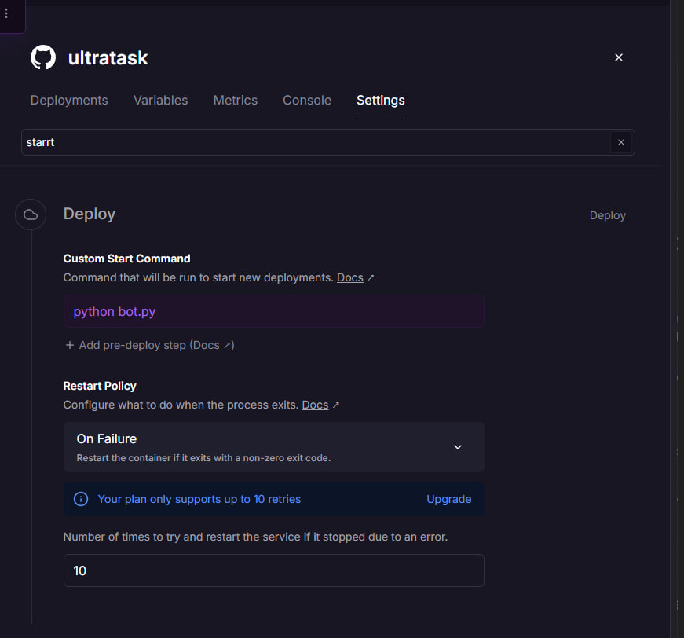
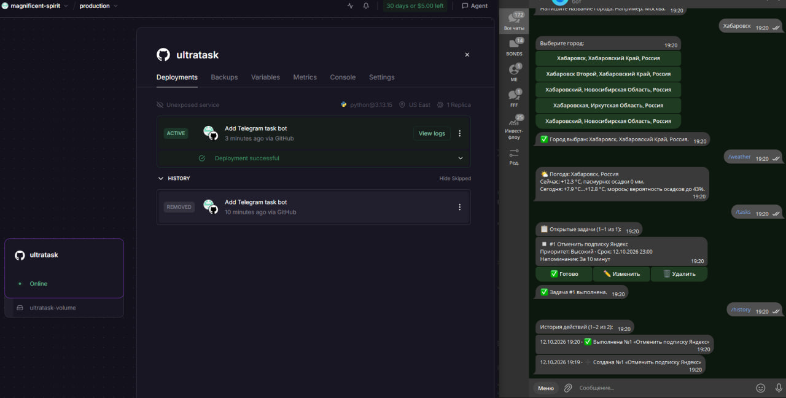
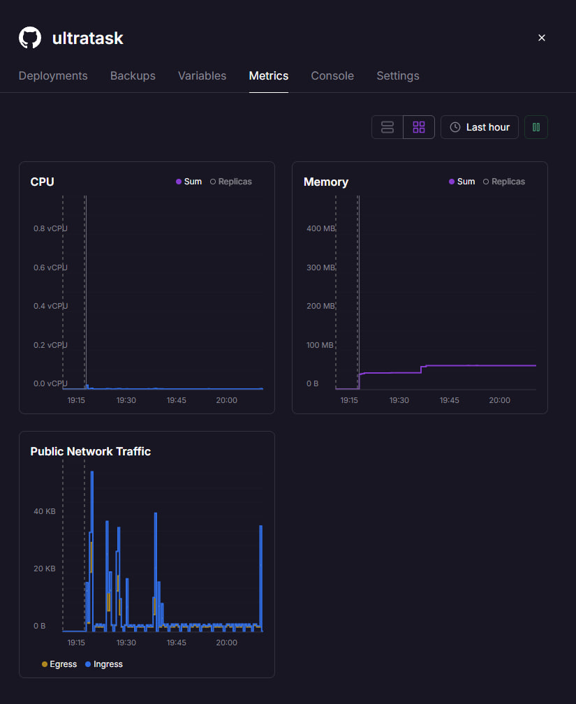
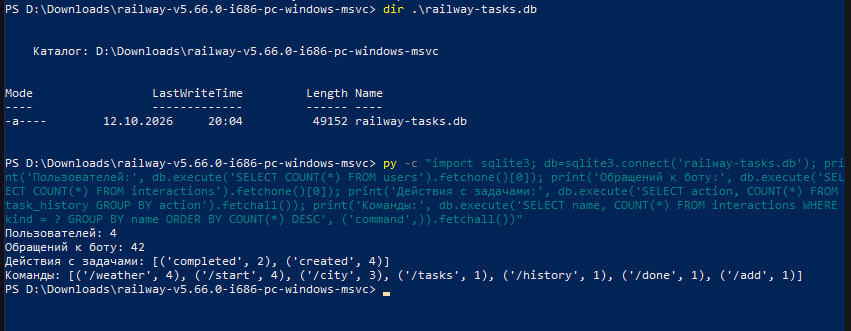
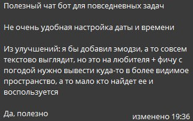
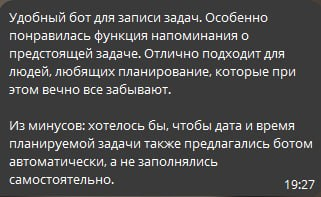
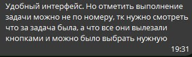
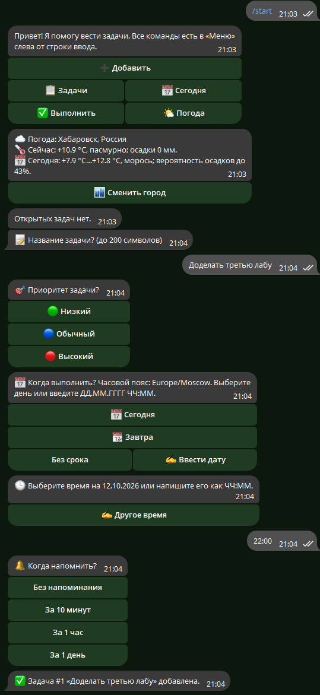

# Отчёт по лабораторной работе № 3

## Запуск Telegram-бота для реального использования

**Проект:** бот личных задач UltraTask  
**Дата отчёта:** 12.10.2026  
**Исходный код:** [GitHub — andrewwbbt/ultratask](https://github.com/andrewwbbt/ultratask)  
**Платформа:** Railway, проект `magnificent-spirit`, окружение `production`, сервис `ultratask`  
**Основные файлы:** [bot.py](https://github.com/andrewwbbt/ultratask/blob/main/bot.py), [requirements.txt](https://github.com/andrewwbbt/ultratask/blob/main/requirements.txt), [README.md](https://github.com/andrewwbbt/ultratask/blob/main/README.md)

> **Состояние работы.** Бот развернут, получены три отзыва, изменения по отзывам внедрены и новая версия работает в Telegram».

## 1. Цель и выбор способа развёртывания

Цель лабораторной — сделать бота доступным пользователям вне компьютера разработчика, проверить его работу, собрать обратную связь и улучшить продукт. Выбран **Railway**: он запускает сервис из GitHub-репозитория и позволяет задать переменные окружения и постоянный том для SQLite.

Бот получает сообщения через `Application.run_polling()` в [bot.py](https://github.com/andrewwbbt/ultratask/blob/main/bot.py). Поэтому для текущего варианта **не требуются** публичный URL Railway, ngrok и настройка Telegram webhook. Команда запуска сервиса — `python bot.py`; отдельный `Procfile` также не нужен, так как команда уже задана в настройках Railway.

## 2. Подготовка проекта к деплою

| Требование | Реализация |
| --- | --- |
| Исходный код доступен для деплоя | Репозиторий загружен на GitHub и подключён к Railway. |
| Зависимости | Перечислены в [requirements.txt](https://github.com/andrewwbbt/ultratask/blob/main/requirements.txt): `python-telegram-bot[job-queue]`, `python-dotenv`, `tzdata`, `httpx`. |
| Секреты | Код читает `BOT_TOKEN` из окружения; пример значений находится в [.env.example](https://github.com/andrewwbbt/ultratask/blob/main/.env.example). Локальный `.env` исключён из Git через [.gitignore](https://github.com/andrewwbbt/ultratask/blob/main/.gitignore). |
| База данных | `DB_PATH` задаёт путь к файлу SQLite. Для постоянного хранения на Railway нужен путь `/data/tasks.db` при томе, смонтированном в `/data`. Фактическое текущее значение переменной на Railway следует проверить отдельно. |
| Логирование и ошибки | Используется `logging`; общий обработчик сообщает пользователю об ошибке и записывает исключение в лог. |
| Личные данные | Файлы SQLite, журналы и виртуальное окружение исключены из Git. Данные пользователей разделены по Telegram ID. |

На скриншоте настроек Railway показана команда запуска `python bot.py` и политика перезапуска при ошибке:



## 3. Деплой в Railway

1. Локальный проект отправлен в репозиторий `andrewwbbt/ultratask` на GitHub.
2. В Railway создан сервис `ultratask` из этого репозитория.
3. Для SQLite создан том `ultratask-volume` с точкой монтирования `/data`.
4. Для сервиса заданы переменные `BOT_TOKEN`, `TIMEZONE` и `DB_PATH`; путь к базе должен быть `/data/tasks.db`.
5. В настройках запуска указано `python bot.py`.
6. После получения отзывов изменения отправлены в GitHub. Проверенный локально коммит улучшений — `2845485` (`Improve task shortcuts and weather UX from tester feedback`). Последний деплой этого коммита имел статус `SUCCESS` по проверке через Railway CLI.

На предоставленном скриншоте Railway отмечает деплой как успешный; рядом показано использование бота в Telegram:



## 4. Тестирование после деплоя

Проверка в Telegram, отражённая на скриншотах, охватывает `/start`, выбор города, `/weather`, список задач, выполнение задачи, `/history` и работу нового интерфейса добавления задачи. Новый скриншот показывает прогноз, кнопки «Сегодня» и «Завтра», ввод другого времени и подтверждение добавления задачи.

Локально для актуального кода запущено:

```powershell
.\.venv\Scripts\python.exe -m unittest -q test_feedback_ux test_weather test_history_search
```

**Результат:** 16 тестов, все прошли. Они проверяют сценарии выбора срока, запрет времени в прошлом, выбор задачи для выполнения по названию, сохранение города при обновлении структуры базы, погодные ответы, историю, поиск и разделение данных пользователей.

Скриншот Railway Metrics показывает низкую нагрузку на CPU и память без заметного роста в **показанном интервале около часа**. Стабильная работа на протяжении 2 часов подтверждена.



## 5. Использование реальными пользователями

Для анализа использована копия SQLite-базы, скачанная с тома Railway. На скриншоте консоли зафиксирован следующий **снимок на 12.10.2026 около 20:04**:

| Показатель | Значение |
| --- | ---: |
| Пользователи в таблице `users` | 4 |
| Взаимодействия в таблице `interactions` | 42 |
| Записи истории о создании задач | 4 |
| Записи истории о выполнении задач | 2 |

Среди записанных команд: `/weather` — 4, `/start` — 4, `/city` — 3, `/tasks` — 1, `/history` — 1, `/done` — 1, `/add` — 1. Это **число записей в базе на момент выгрузки**, а не текущее число активных пользователей. Таблица `interactions` учитывает также кнопки и сообщения, поэтому сумма перечисленных команд меньше 42.



Примеры использования: выбор города и просмотр прогноза; создание задачи со сроком и напоминанием; просмотр и выполнение задачи; просмотр истории действий. Они видны на скриншоте деплоя с Telegram и на снимке обновлённого интерфейса ниже.

## 6. Собранная обратная связь

Предоставлены **три текста отзывов**. На скриншотах нет данных, позволяющих независимо подтвердить, что это три разных человека; перед сдачей работы это следует уточнить у автора сбора отзывов. Личные имена в отчёт не добавлены.

| Отзыв | Что понравилось | Замечание или пожелание |
| --- | --- | --- |
| 1 | Бот полезен для повседневных задач. | Неудобно задавать дату и время; предложено добавить эмодзи для более понятного интерфейса. |
| 2 | Удобная запись задач и напоминания о предстоящих делах. | Дату и время хотелось бы выбирать из предложенных ботом вариантов. |
| 3 | Удобный интерфейс. | Выполнение задачи хотелось бы отмечать выбором из списка кнопок, а не только вводом номера. |







## 7. Изменения на основе отзывов

Приоритет был отдан сценариям, которые мешали выполнять основное действие — добавлять и завершать задачи. Дополнительно улучшено представление погоды по отдельному запросу владельца проекта.

| Проблема | Изменение | Подтверждение |
| --- | --- | --- |
| Дату и время приходилось вводить полностью вручную. | При добавлении и редактировании задачи появились кнопки «Сегодня», «Завтра», «Без срока», «Ввести дату»; после выбора дня предлагаются часы или ввод другого времени. Прошедшее время отклоняется. | Сценарий добавления виден на новом скриншоте; логика проверена тестами. |
| Задачу для выполнения было трудно выбрать по номеру. | `/done` без аргумента показывает открытые задачи кнопками с названием; вариант `/done НОМЕР` сохранён. Кнопки используют постоянный внутренний ID задачи. | Проверено автоматическим тестом; отдельный скриншот работы этой кнопки после деплоя пока не приложен. |
| Текстовые подсказки выглядели однообразно. | В основные вопросы, приоритеты и подтверждения добавлены эмодзи; подтверждение включает название задачи. | Видно в новом сценарии добавления. |
| Погоду хотелось видеть в главном интерфейсе. | В `/start` добавлена кнопка «Погода», прогноз стал более структурированным, под ответом есть кнопка «Сменить город». | Кнопки и прогноз видны на новом скриншоте. |

Запрос на изменения в истории общения был кратким: «Улучши эти 4 пункта для бота». Уточнения этих пунктов были сформированы в предыдущем обсуждении отзывов и погоды.

**Обновлённый бот после отзывов:** на скриншоте видны кнопки погоды, варианты даты, ввод времени и успешное создание задачи.



## 8. Трудности и решения

| Трудность | Решение |
| --- | --- |
| Бот хранит SQLite-файл; обычная файловая система облачного контейнера не подходит для постоянных данных. | Подключён том Railway в `/data`; путь базы вынесен в `DB_PATH`. Текущее значение переменной нужно ещё проверить в интерфейсе Railway. |
| В инструкции к лабораторной приведён webhook, а программа использует polling. | Сервис запускается как постоянно работающий процесс через `python bot.py`; webhook для этого кода не настраивается. |
| Для отчёта нужны показатели использования, а Railway Metrics показывает только ресурсы сервиса. | База скачана с тома Railway, статистика посчитана по `users`, `interactions` и `task_history`. |
| Часть пользователей затруднялась с датой и выбором задачи. | Добавлены предложенные даты и часы, а также кнопки выбора задачи; изменения покрыты тестами. |

## 9. Выводы

Бот вышел за пределы локального запуска: код размещён на GitHub, Railway выполняет его как постоянно работающий сервис, SQLite хранит пользовательские данные, а скриншоты подтверждают использование бота в Telegram. Снимок базы зафиксировал 4 пользователей и 42 взаимодействия. На основе трёх отзывов улучшены ввод срока, выбор задачи и оформление; дополнительная доработка сделала погоду доступнее из главного меню.
